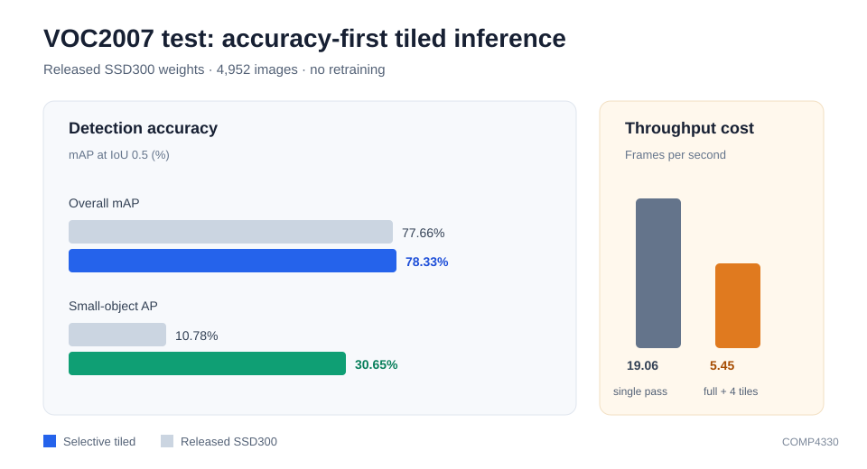

# COMP4330: Small-Object Detection on VGG16-SSD300

This repository contains the code and reproducible experiment records for a
COMP4330 course project on small-object detection with VGG16-SSD300.

The final selected method is **Selective Tiled Inference**. It keeps the
released SSD300 VOC0712 checkpoint unchanged and combines full-image and
local-tile detections at inference time.

| Metric | Released SSD300 | Selective Tiled Inference |
|---|---:|---:|
| Overall mAP@0.5 | 77.66% | **78.33%** |
| Small AP@0.5 | 10.78% | **30.65%** |
| Small recall@0.5 | 77.05% | **90.99%** |
| Medium AP@0.5 | 63.07% | 60.54% |
| Large AP@0.5 | 85.97% | 84.97% |
| FPS | 19.06 | 5.45 |

The result is measured on the complete 4,952-image VOC2007 test set. The
method is accuracy-first: it performs five detector passes per image and is
not intended as a real-time replacement for single-pass SSD300.



## Final method

For each image:

1. Run SSD300 on the full image.
2. Run SSD300 on four tiles with 20% overlap.
3. Map tile detections back to full-image coordinates.
4. Keep only tile detections in the small-object area range.
5. Merge full-image and tile detections with per-class NMS.

The fixed final parameters are:

- tile grid: `2 x 2`
- overlap: `0.2`
- full-image pass: enabled
- maximum resized tile-detection area: `32 x 32 = 1024`
- NMS IoU: `0.45`
- tile score scale: `1.0`

The method changes no model weights. Its main limitation is latency:
`183.59 ms/image` and `5.45 FPS` on the recorded T4 runtime.

## Quick start in Colab

Open the final notebook:

https://colab.research.google.com/github/itsvvy/comp4330-ssd-fusion/blob/main/notebooks/COMP4330_sef_runner.ipynb

Use **Runtime > Change runtime type > T4 GPU**. The notebook:

- clones this repository;
- installs dependencies;
- downloads and verifies VOC0712 and the SSD300 checkpoint into ephemeral
  `/content` storage;
- runs the tests and a five-image inference smoke check.

The full evaluation is opt-in because it takes about 20 minutes.

## Reproduce the final result

```bash
bash scripts/download_assets.sh \
  /content/assets \
  /content/data/VOCdevkit

python tools/tiled_eval.py \
  --trained_model /content/assets/weights/ssd300_mAP_77.43_v2.pth \
  --voc_root /content/data/VOCdevkit \
  --save_folder /content/results/full_tiled_small \
  --variant baseline \
  --tile_grid 2 \
  --overlap 0.2 \
  --include_full \
  --tile_max_area 1024

python tools/size_stratified_eval.py \
  --detections /content/results/full_tiled_small/detections.pkl \
  --voc-root /content/data/VOCdevkit \
  --output /content/results/full_tiled_small/size_metrics.json
```

For a fast check, add `--limit 5` to both inference and size evaluation. Do
not use the limited result as a project metric.

The recorded result and all parameters are in
[`reports/tiled_inference_results.md`](reports/tiled_inference_results.md) and
[`reports/tiled_inference_results.json`](reports/tiled_inference_results.json).

## Fusion study

The project also includes the original controlled `M0-FT`, `C`, and `M1`
comparison from the proposal:

| Arm | Purpose |
|---|---|
| `M0-FT` | Same-budget fine-tuned baseline |
| `C` | Parameter-matched control without cross-scale input |
| `M1` | `conv7 -> conv4_3` zero-gated fusion |

All three use 6,000 iterations, the same optimizer schedule, and seed `1337`.
The formal result is in
[`reports/formal_6k_results.md`](reports/formal_6k_results.md).

The fusion result was effectively neutral. Gate diagnostics in
[`reports/fusion_gate_validation.md`](reports/fusion_gate_validation.md)
explain why the original branch had little effect. Follow-up fusion structures
were screened and rejected without changing the final tiled result.

## Environment and assets

The recorded GPU runs used:

- Google Colab Tesla T4, 14.6 GiB VRAM
- Python `3.13.16`
- PyTorch `2.11.0+cu130`
- CUDA `13.0`

The asset script downloads:

- VOC2007 trainval/test
- VOC2012 trainval
- `ssd300_mAP_77.43_v2.pth`
- `vgg16_reducedfc.pth`

`scripts/download_assets.sh` writes and verifies `SHA256SUMS.json`. Dataset
files and checkpoints are intentionally excluded from Git.

## Tests

The code has CPU tests for model shapes, zero-gate behavior, checkpoint
loading, VOC size binning, result aggregation, tile coordinate mapping, and
tile merging.

```bash
python -m pytest -q
```

The full suite was last verified on the frozen final code path before the
release tag.

## Repository layout

```text
configs/       pre-registered training configurations
data/          VOC/COCO loaders from the upstream project
layers/        SSD losses, priors, decoding, and detection
notebooks/     final Colab runner
reports/       frozen metrics, diagnostics, and final summary
scripts/       asset, training, and result-summary entry points
tests/         CPU and synthetic evaluation tests
tools/         size-stratified and tiled evaluation
```

## Branches and experiment history

`main` contains the validated final method and the formal fusion comparison.
Experimental work remains on independent branches:

- `experiment/tiled-small-objects`: final selective tiled inference
- `experiment/m0-ft-6k`, `experiment/control-6k`,
  `experiment/m1-fusion-6k`: formal three-arm comparison
- `experiment/m1-gatefix`: fusion gate diagnostics and repair attempts
- `experiment/multiscale-fusion`: rejected multiscale residual fusion screen
- `experiment/highres-small-head`: rejected 75x75 auxiliary-head screen

No pushed branch is rewritten or deleted. The final frozen state is identified
by the `course-final-v1.0.0` tag.

## Limitations

- Selective tiled inference reduces throughput by about 3.5 times.
- Medium and large AP decrease slightly.
- Fusion experiments use one seed.
- FPS is a Colab measurement and should not be treated as a hardware benchmark.
- Raw checkpoints and detections are not stored in Git; they can be regenerated
  with the pinned assets and commands above.

The source is based on the MIT-licensed
[`amdegroot/ssd.pytorch`](https://github.com/amdegroot/ssd.pytorch), pinned at
commit `5b0b77faa955c1917b0c710d770739ba8fbff9b7`. The MIT license is retained.
