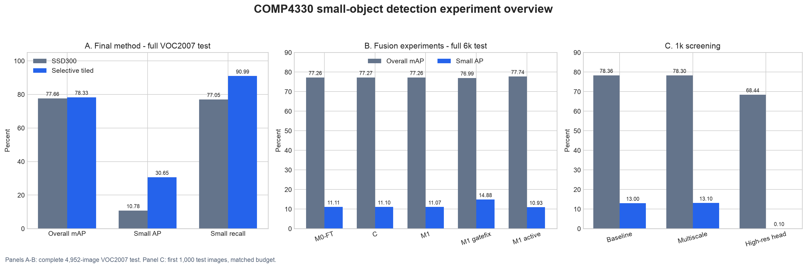

# COMP4330: Small-Object Detection on VGG16-SSD300

This repository records a COMP4330 course project that tested whether
cross-scale feature fusion could reduce the small-object weakness of
VGG16-SSD300. The controlled fusion study produced a negative result. The
selected final method therefore changes only inference: **Selective Tiled
Inference** magnifies local image regions while keeping the released detector
weights unchanged.

## Start here

| Reader question | Document |
|---|---|
| Why did the feature-fusion idea fail? | [`reports/experiment_history.md`](reports/experiment_history.md) |
| What is the final measured result? | [`reports/final_project_summary.md`](reports/final_project_summary.md) |
| Which artifact contains which experiment? | [`reports/README.md`](reports/README.md) |
| Where is the chronological run log? | [Colab experiment record](https://colab.research.google.com/drive/1kTnOphcCSUmjX6UQpEoj4zWjvLR-Fp5R) |
| How do I run the reproducible final path? | [Final Colab runner](https://colab.research.google.com/github/itsvvy/comp4330-ssd-fusion/blob/main/notebooks/COMP4330_sef_runner.ipynb) |

## 1. Problem and baseline

SSD300 is already a multi-scale detector: its detection heads predict from
several feature maps. The problem addressed here is not a missing
multi-scale prediction path. The proposed experiment instead asked whether
semantic information from `conv7` and deeper layers could improve the
higher-resolution `conv4_3` prediction map through lightweight top-down
fusion.

The released VGG16-SSD300 VOC0712 checkpoint gives the following VOC2007 test
baseline on all 4,952 images:

| Metric | Released SSD300 |
|---|---:|
| Overall mAP at IoU 0.5 | 77.66% |
| Small AP at IoU 0.5 | 10.78% |
| Small recall at IoU 0.5 | 77.05% |
| Medium AP at IoU 0.5 | 63.07% |
| Large AP at IoU 0.5 | 85.97% |

Small AP is far below large AP. The working hypothesis was that the
`38 x 38` `conv4_3` map lacks the semantic context available in deeper
feature maps, and that a controlled `conv7 -> conv4_3` branch could recover
part of that gap without changing the rest of the detector.

## 2. Feature-fusion investigation

### 2.1 Controlled 6k comparison

All three formal arms used the same VOC0712 data, released checkpoint,
6,000-iteration schedule, optimizer schedule, seed `1337`, augmentation, and
evaluation code.

| Arm | Change | Overall mAP | Small AP | Result |
|---|---|---:|---:|---|
| `M0-FT` | Fine-tuned released model | 77.26% | 11.11% | Shared-budget baseline |
| `C` | Extra branch capacity without cross-scale input | 77.27% | 11.10% | Capacity alone did not help |
| `M1` | Zero-gated `conv7 -> conv4_3` fusion | 77.26% | 11.07% | No measurable fusion gain |

`C` is **parameter-matched, not FLOPs-matched**. It has 27,076,765 parameters
versus 27,076,527 for `M1`, but its wider `38 x 38` bottleneck costs about
`1,143M` MACs versus about `574M` for `M1`. It therefore isolates additional
parameter capacity, not matched computation. The FLOPs mismatch is retained
as part of the experiment record and limits how narrowly the control can be
interpreted.

### 2.2 Why the first `M1` branch was inactive

Targeted diagnostics explained the near-zero result:

- the branch output RMS was about 4.6% of the normalized `conv4_3` RMS with
  the released backbone;
- at gate zero, all fusion-convolution gradients were exactly zero on the
  first optimizer step;
- only the scalar gate received an initial gradient, and the gate moved very
  slowly during 6k training.

The branch was implemented correctly. Its zero-gate initialization and feature
scale made activation much slower than expected.

### 2.3 Repairs and forced activation

| Experiment | What changed | Full-test result | Explanation |
|---|---|---|---|
| Normalized gate repair | Normalized branch features, zero-initialized pointwise output, scale starts at `1.0` | Overall 76.99%, small AP 14.88%, small recall 81.41% | Small AP rose, but medium/large degradation lowered overall mAP; the final branch output later collapsed to zero |
| Forced-active fusion | Non-zero output initialization, normalized branch, fixed scale `0.05`, frozen VGG16 | Overall 77.74%, small AP 10.93%, small recall 77.12% | The branch remained active at about 7.7% relative contribution, but still did not improve small AP |

The forced-active run is the key diagnostic: it separated "the gate did not
open" from "the fusion idea works." Even with a measured active branch, the
targeted metric did not improve. The normalized repair produced a local
small-AP increase but regressed overall performance and did not remain active
at the end of training.

### 2.4 Alternative fusion structures

Both alternatives used matched 1,000-iteration screens on the first 1,000
VOC2007 test images.

| Screen | Change | Overall mAP | Small AP | Outcome |
|---|---|---:|---:|---|
| Baseline | Frozen control | 78.36% | 13.00% | Screen reference |
| Multiscale residual fusion | Fused `conv4_3`, `conv7`, `conv8_2`, and `conv9_2` | 78.30% | 13.10% | Noise-level change; rejected |
| High-resolution auxiliary head | Added a `75 x 75` `conv3_3` head with 22,500 priors | 68.44% | 0.10% | Severe false-positive ranking and latency regression |

The multiscale screen traded `0.06 pp` overall mAP for `0.10 pp` small AP and
also reduced small recall. It does not provide usable evidence of a gain.

### 2.5 Research conclusion

The feature-fusion hypothesis was not supported by the available experiments.
The outcome is not explained only by the initial zero gate: normalization
temporarily raised small AP but lowered overall mAP and later collapsed to
zero, while forced activation kept the branch active but did not improve small
AP. We retained these negative results because they narrow the design choice
and explain why the final method shifts from learned feature fusion to
input-scale adaptation.

The complete sequence and branch-specific evidence are in
[`reports/experiment_history.md`](reports/experiment_history.md).

## 3. Final effective method

### 3.1 Selective Tiled Inference

For each image:

1. Run SSD300 on the full image.
2. Run SSD300 on four tiles with 20% overlap.
3. Map tile detections back to full-image coordinates.
4. Retain tile detections only when their resized box area is at most
   `32 x 32 = 1024` pixels.
5. Merge full-image and tile detections with per-class NMS at IoU `0.45`.

The fixed configuration is:

- tile grid: `2 x 2`
- overlap: `0.2`
- full-image pass: enabled
- maximum resized tile-detection area: `1024`
- NMS IoU: `0.45`
- tile score scale: `1.0`

The model checkpoint is unchanged. Only inference is modified.

### 3.2 Full VOC2007 test result

| Metric | Released SSD300 | Selective Tiled | Delta |
|---|---:|---:|---:|
| Overall mAP at IoU 0.5 | 77.66% | **78.33%** | **+0.67 pp** |
| Small AP at IoU 0.5 | 10.78% | **30.65%** | **+19.87 pp** |
| Small recall at IoU 0.5 | 77.05% | **90.99%** | **+13.94 pp** |
| Medium AP at IoU 0.5 | 63.07% | 60.54% | -2.54 pp |
| Large AP at IoU 0.5 | 85.97% | 84.97% | -1.00 pp |
| Latency | 52.45 ms/image | 183.59 ms/image | +131.14 ms |
| FPS | 19.06 | 5.45 | -13.62 |

The result is computed on all 4,952 test images. The 500-image pilot used the
same frozen inference parameters and was checked before the complete run; the
project metric is the complete-test result, not the pilot.



The figure is generated from frozen experiment data by
[`scripts/plot_results.py`](scripts/plot_results.py) using Matplotlib.

### 3.3 Why the selectors matter

Keeping every tile detection was tested first and reduced overall mAP to
63.32%. Tiles produced many duplicated and high-scoring false detections that
overwrote stronger full-image predictions.

Retaining tile detections only in the small-object area range directs the new
detections toward the failed scale bin while preserving the medium/large
predictions from the full-image SSD pass. This is why the final method keeps
the full-image pass and uses tiles selectively rather than replacing the
original inference path.

### 3.4 Cost

The method performs five SSD300 passes per image. It is an accuracy-first
small-object enhancement, not a real-time replacement for single-pass SSD300.
Small AP and small recall improve substantially; medium and large AP decrease
slightly, and throughput falls by about 3.5 times.

## 4. Conclusion and reproduction

### 4.1 Final conclusion

The controlled feature-fusion study is a useful negative result: a local
`conv7 -> conv4_3` branch did not deliver a reliable gain under the available
training budget. Selective Tiled Inference is the selected final method
because it produces a large, directly measured improvement in the targeted
small-object metrics on the complete test set.

The concise result summary is
[`reports/final_project_summary.md`](reports/final_project_summary.md). Exact
values and parameters are in
[`reports/tiled_inference_results.md`](reports/tiled_inference_results.md) and
[`reports/tiled_inference_results.json`](reports/tiled_inference_results.json).

### 4.2 Reproduce the final result

Run these commands from the repository root:

```bash
bash scripts/download_assets.sh \
  /content/assets \
  /content/data/VOCdevkit

python tools/tiled_eval.py \
  --trained_model /content/assets/weights/ssd300_mAP_77.43_v2.pth \
  --voc_root /content/data/VOCdevkit \
  --save_folder /content/results/full_tiled_small \
  --variant baseline \
  --tile_grid 2 \
  --overlap 0.2 \
  --include_full \
  --tile_max_area 1024

python tools/size_stratified_eval.py \
  --detections /content/results/full_tiled_small/detections.pkl \
  --voc-root /content/data/VOCdevkit \
  --output /content/results/full_tiled_small/size_metrics.json
```

For a smoke check, add `--limit 5` to both evaluation commands. Limited results
are not project metrics.

To regenerate the experiment overview:

```bash
python scripts/plot_results.py \
  --history reports/experiment_history.json \
  --output-dir reports/figures
```

### 4.3 Environment and tests

The recorded runs used:

- Google Colab Tesla T4, 14.6 GiB VRAM
- Python `3.13.16`
- PyTorch `2.11.0+cu130`
- CUDA `13.0`

`scripts/download_assets.sh` downloads VOC2007 trainval/test, VOC2012
trainval, and both SSD300 checkpoints into Colab storage, then verifies them
with `SHA256SUMS.json`. Datasets and checkpoints are not committed to Git.

Run the CPU tests with:

```bash
python -m pytest -q
```

The suite covers model shapes, zero-gate behavior, checkpoint loading, VOC size
binning, result aggregation, tile coordinate mapping, and tile merging. It was
last run on the frozen final code path in the validated Colab runner.

### 4.4 Repository map

```text
configs/       training configurations
data/          VOC/COCO data loaders
layers/        SSD losses, priors, decoding, and detections
notebooks/     cleaned Colab runner
reports/       frozen metrics, diagnostics, narrative, and figures
scripts/       asset, training, plotting, and result-summary entry points
tests/         CPU and synthetic evaluation tests
tools/         size-stratified and selective tiled evaluation
```

The main branch contains the final method and consolidated fusion evidence.
Independent experiment branches retain the original work:

- `experiment/tiled-small-objects`: selective tiled inference
- `experiment/m0-ft-6k`, `experiment/control-6k`,
  `experiment/m1-fusion-6k`: controlled three-arm comparison
- `experiment/m1-gatefix`: gate diagnostics and repair attempts
- `experiment/multiscale-fusion`: rejected multiscale residual screen
- `experiment/highres-small-head`: rejected high-resolution head screen

No pushed branch is rewritten or deleted. The current frozen documentation and
result state is identified by the `course-final-v1.0.5` tag.

### 4.5 Limitations

- Selective tiled inference reduces throughput by about 3.5 times.
- Medium and large AP decrease slightly.
- The 500-image pilot and complete evaluation use the same frozen inference
  configuration; only the complete-test numbers are used for the final claim.
- Fusion experiments use one seed and do not establish statistical
  significance.
- FPS is a Colab measurement and depends on runtime conditions.
- Raw checkpoints and detections are generated artifacts and are not committed.

The source is based on the MIT-licensed
[`amdegroot/ssd.pytorch`](https://github.com/amdegroot/ssd.pytorch), pinned at
commit `5b0b77faa955c1917b0c710d770739ba8fbff9b7`. The MIT license is retained.
